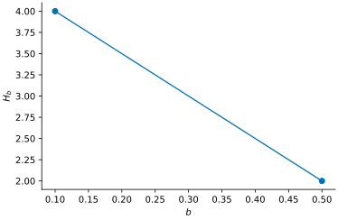

# VsusP

VsusP selects variables from shrinkage-prior posterior coefficient draws.
It provides sequential two-means (S2M), basic two-means (2-M), spike-and-slab
inclusion summaries, the signal adaptive variable selector (SAVS), and an
adaptive-L1 approximation to decoupling shrinkage and selection (DSS). Native Gaussian
ridge, horseshoe and spike-and-slab fits provide coefficient draws in Python.

## Install

```sh
pip install vsusp
```

From GitHub:

```sh
python -m pip install "git+https://github.com/nilson01/vsusp-python.git"
```

Or from a local source directory:

```sh
python -m pip install .
```

For plots and sampling diagnostics:

```sh
pip install "vsusp[plots,diagnostics]"
```

## Select variables

Rows contain posterior draws; columns contain coefficients. Exclude the intercept.

```python
import numpy as np
from vsusp import s2m

beta = np.array([[.01, .02, .03, .3, .31, 10, 11],
                 [-.01, -.02, -.03, -.3, -.31, -10, -11]])
path = s2m(beta, [.1, .5])
print(path.summary())
print(path.select(1).selected_names)
# ('x7', 'x6')
```

Indices are zero-based. The first threshold has index 0. The path shows the
selected count at each threshold; it does not choose an optimal threshold.



## Choose an analysis

| Task | Function |
|---|---|
| Gaussian shrinkage fitting | `fit_ridge`, `fit_horseshoe`, `fit_spike_slab` |
| Supplied-draw selection | `s2m`, `two_means`, `select` |
| Spike inclusion summaries | `spike_slab` |
| Sparse coefficient summaries | `savs`, `dss` |
| Sampling diagnostics | `diagnostics` |
| Plots | `plot_tuning`, `plot_coefficients`, `plot_inclusion`, `plot_trace`, `plot_autocorrelation` |

The [documentation website](https://nilson01.github.io/vsusp-python/) includes
the [tutorials](docs/tutorials.md) cover fitting, prediction and spike-and-slab
draws. The [API reference](docs/api.md) lists inputs and outputs.
The [reference manual](docs/manual/vsusp-manual.pdf) collects the examples, methods and API.

## Interpretation

S2M counts and ranking summaries are not posterior inclusion probabilities.
Only exact-zero spike-and-slab draws support `spike_slab` inclusion frequencies.
SAVS and DSS can return an empty selection. Their sparse coefficients depend on
the stated design and penalty conventions.

Python uses deterministic exact two-means clustering by default. The R package
uses randomized k-means by default. The optional Python `kmeans` backend uses
NumPy Lloyd iterations and does not reproduce R's random-number stream.

Assess chain mixing and tuning sensitivity before interpreting fitted results.
Short examples and numerical agreement do not establish false-discovery control
or general selection accuracy. See [methods and limits](docs/methods.md).

## Citation

Chapagain, N. (2026). [VsusP: Variable selection from Bayesian shrinkage priors in R and Python](https://www.researchgate.net/publication/416922764_VsusP_Variable_selection_from_Bayesian_shrinkage_priors_in_R_and_Python). Preprint.

Cite the statistical methods used and record the VsusP version.

```bibtex
@misc{chapagain2026vsusp,
  author = {Chapagain, Nilson},
  title = {{VsusP: Variable selection from Bayesian shrinkage priors in R and Python}},
  year = {2026},
  howpublished = {Preprint, ResearchGate},
  url = {https://www.researchgate.net/publication/416922764_VsusP_Variable_selection_from_Bayesian_shrinkage_priors_in_R_and_Python}
}
```

## References

Li, H. and Pati, D. (2017). Variable selection using shrinkage priors.
[Computational Statistics & Data Analysis, 107, 107–119](https://doi.org/10.1016/j.csda.2016.10.008).

Ray, P. and Bhattacharya, A. (2018). [Signal Adaptive Variable Selector for the
Horseshoe Prior](https://arxiv.org/abs/1810.09004).

Hahn, P. R. and Carvalho, C. M. (2015). Decoupling Shrinkage and Selection in
Bayesian Linear Models: A Posterior Summary Perspective.
[JASA, 110, 435–448](https://doi.org/10.1080/01621459.2014.993077).

Numerical evidence: [fixed posterior checks](docs/validation.md).

License and source attribution: [NOTICE](NOTICE.md).

## Acknowledgements

Computations were performed on the Arseven Computing Cluster, Department of
Statistics, Texas A&M University.

This work received no grant funding.
