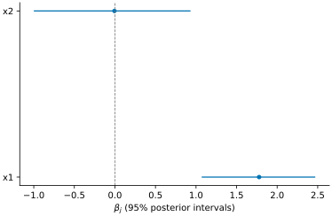
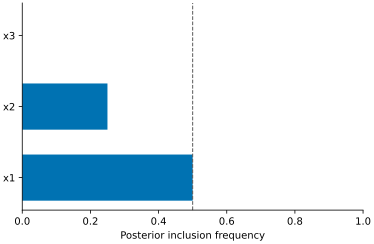
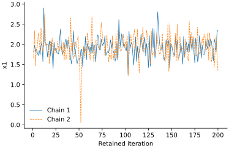
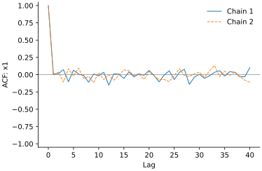

# Tutorials

## Gaussian regression

```python
import numpy as np
from vsusp import fit_ridge, s2m

X = np.array([[-2, 0], [-1, 1], [0, -1], [1, 0], [2, 1], [0, -1.]])
y = np.array([-3.8, -2.1, .1, 2.2, 3.9, -.2])
fit = fit_ridge(X, y, draws=200, chains=2, random_state=12)
print(fit.summary())
prediction = fit.predict(X)
path = s2m(fit.pooled_draws(), [.1, .5], feature_names=fit.feature_names)
print(path.summary())
```

`prediction` contains posterior means and pointwise equal-tail intervals for the
conditional mean. Use `include_noise=True, random_state=12` for new-observation
intervals. The ridge draws are independent posterior draws. Horseshoe and
spike-and-slab fitting use Gibbs sampling instead.

## Spike-and-slab draws

```python
from vsusp import fit_spike_slab, spike_slab

fit = fit_spike_slab(X, y, draws=200, burnin=100, chains=2, random_state=12)
selection = spike_slab(fit.pooled_draws(), feature_names=fit.feature_names)
print(selection.summary())
```

Excluded coefficients are exactly zero. `mpm` includes variables with inclusion
frequency at least 0.5. `hppm` is the most frequent complete model visited by the
draws. It does not certify the most probable model among unvisited models.
This short chain illustrates the call; use longer runs and inspect mixing for
an analysis. S2M needs `zero_draws="empty"` to accept entirely zero draws.

## Sparse prediction

```python
from vsusp import savs, dss

beta_mean = fit.pooled_draws().mean(axis=0)
print(savs(X, beta_mean).summary())
sparse = dss(X, beta_mean, penalty=.1)
print(sparse.summary())
```

Use the same column order and units as the supplied coefficients. DSS approximates
`X @ beta_mean`; its approximation error is not held-out predictive error.
Check `sparse.converged` before using it. Neither method selects a penalty by
cross-validation or estimates false-discovery rates.

## Diagnostics and plots

```python
from vsusp import diagnostics, plot_trace, plot_tuning

print(diagnostics(fit).summary())
plot_trace(fit, variable=0)
plot_tuning(path)
```

Diagnostics preserve chain identities. Constant variables and single-chain
R-hat are reported as unavailable. A good R-hat alone does not establish that a
multimodal posterior was fully explored. Plot functions return Matplotlib axes;
use `ax.figure.savefig("figure.pdf")` to save them.

## Illustrative figures


The tuning path uses the fixed supplied rows, not a simulation study.



The ridge illustration has six observations, two predictors and 400 independent
posterior draws. Intervals describe this posterior, not selection accuracy.



These four fixed rows illustrate inclusion counting; they are not fitted data.





The horseshoe illustration uses two chains, 100 burn-in iterations and 200
retained draws per chain, with root seed 12. These short traces illustrate the
displays; they do not establish convergence. The figure script and all plotted
coefficient draws are provided in `examples/figures.py` and `figures/`.
