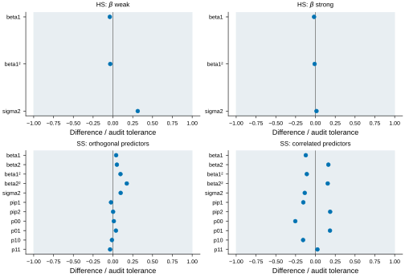
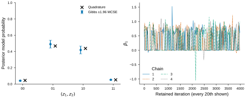

# Numerical validation

## Fixed calculations

Analytic checks cover exact two-means partitions, S2M stopping, SAVS thresholding,
DSS convex optimality, Gaussian conditional draws and the conjugate ridge
posterior. Fixed selection and sparse-coefficient results also agree with the
repaired installed R VsusP 1.0.0.9000 on R 4.5.0. This reference is not the
released CRAN version. Python's default clustering is deterministic; R's is not.

## Native posterior checks

Four fixed seven-observation inputs compare Gibbs draws with numerical
integration. Horseshoe checks use one predictor with weak or strong fitted
signal. Spike-and-slab checks use two orthogonal or correlated predictors.
Each uses four chains with 2000 burn-in and 4000 retained draws per chain.

| Check | Maximum rank R-hat | Minimum bulk ESS | Minimum tail ESS |
|---|---:|---:|---:|
| Horseshoe, weak signal | 1.0017 | 2415 | 2560 |
| Horseshoe, strong signal | 1.0000 | 12322 | 13246 |
| Spike-and-slab, orthogonal | 1.0011 | 2504 | 2504 |
| Spike-and-slab, correlated | 1.0074 | 413 | 400 |

ESS means effective sample size. Compared quantities include coefficient first
and second moments, mean residual variance and, for spike-and-slab, inclusion
and complete-model probabilities. Quadrature refinements changed the targets
by less than 5e-11. Every discrepancy was within the prespecified audit tolerance:
the larger of 0.01 and five estimated Monte Carlo standard errors. These broad
audit thresholds diagnose large errors; they do not prove exact sampling.

The plotted band is a numerical acceptance rule, not a confidence interval.

Error bars show ±1.96 estimated Monte Carlo standard errors. Every twentieth
retained draw is shown in the traces; all draws enter summaries. The model
labels give the two inclusion states. See the [numeric results](validation/native-posterior.json)
and [plot values](figures/posterior-agreement.csv).

## Interpretation

These are low-dimensional posterior checks. They do not establish general
selection accuracy, repeated-dataset interval coverage or high-dimensional
mixing. The full Li–Pati simulations and lymphoma analysis have not been
reproduced. Platform checks are recorded separately from statistical checks.
